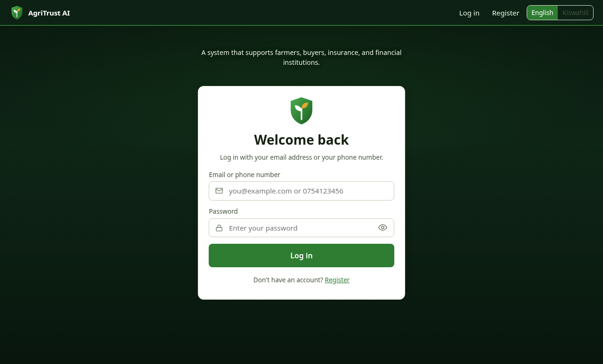
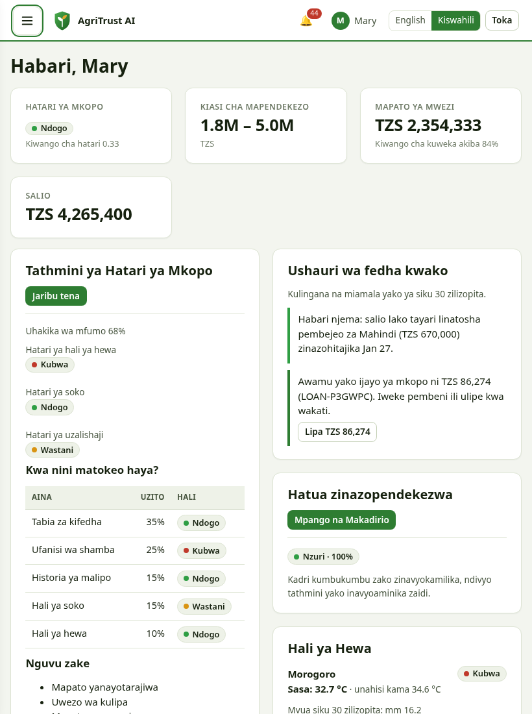
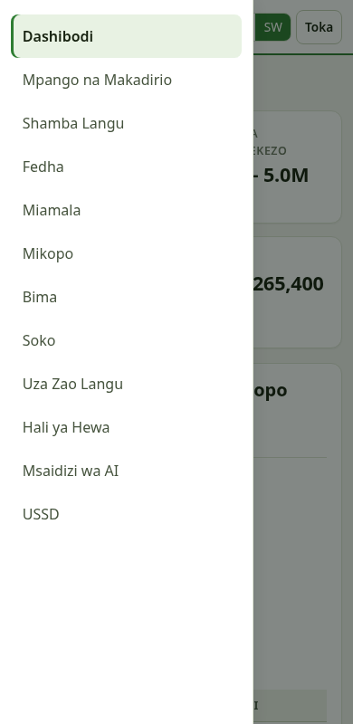
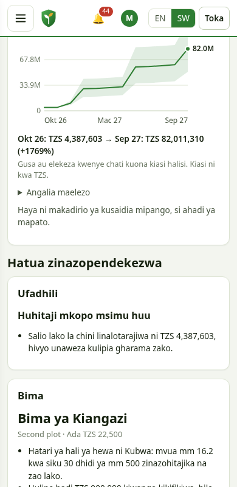

<div align="center">


# AgriTrust AI

**An AI agricultural-finance and risk network for smallholder farmers.**

Assess · Match · Insure · Borrow · Sell · Repay — in English and Kiswahili.


[Quick start](#quick-start) · [Features](#roles-and-features) · [How it works](#how-the-intelligence-works) · [Configuration](#configuration) · [Demo accounts](#demo-accounts)

</div>

AgriTrust AI connects farmers, buyers, insurers, lenders and loan officers on one
platform. It scores a farm's credit risk from real records and weather/market data,
matches the farmer to the financial institutions that will actually lend to them,
insures the season, helps sell the harvest, and gives the loan desk a complete
underwriting workbench. Money maths is always deterministic — the AI explains and
recommends, a human officer decides.

## Screenshots

| Sign in | Farmer dashboard (tablet) |
| --- | --- |
|  |  |

| Phone menu | Charts on a phone |
| --- | --- |
|  |  |

## Quick start

```bash
git clone <your-repo-url> agritrust-ai && cd agritrust-ai
python3 -m venv .venv && source .venv/bin/activate
pip install -r requirements.txt
cp .env.example .env
./scripts/run.sh                 # then open http://127.0.0.1:8000
```

Phone on the same wifi: `HOST=0.0.0.0 ./scripts/run.sh`, then open the LAN address it prints.
Demo logins are in [Demo accounts](#demo-accounts).

---

## Table of contents

- [What the system does](#what-the-system-does)
- [Roles and features](#roles-and-features)
- [The loan officer desk](#the-loan-officer-desk)
- [How the intelligence works](#how-the-intelligence-works)
- [Architecture](#architecture)
- [Technology stack](#technology-stack)
- [Project layout](#project-layout)
- [Quick start](#quick-start)
- [Getting started](#getting-started)
- [Configuration](#configuration)
- [Africa's Talking: SMS and USSD](#africas-talking-sms-and-ussd)
- [Demo accounts](#demo-accounts)
- [Testing](#testing)
- [Internationalisation](#internationalisation)
- [Honesty and safety principles](#honesty-and-safety-principles)

---

## What the system does

Smallholder farmers are often invisible to formal finance: no collateral record, no
transaction history, no way for a bank to price the weather risk of a single season.
AgriTrust AI makes that farmer legible by turning their own farm records into an
assessment a lender can trust — and by keeping every step auditable.

The platform covers the full farmer money loop:

1. **Assess** — a transparent 0–100 credit-risk score with the factors behind it.
2. **Match** — which banks, SACCOs and mobile-money lenders accept this farmer now.
3. **Insure** — parametric cover that pays out automatically when the weather
   crosses an agreed trigger, which lowers the risk and raises the ceiling.
4. **Borrow** — apply for a loan, routed to a real institution with live terms.
5. **Sell** — list the harvest on the buyer marketplace and get paid by mobile money.
6. **Repay** — track instalments, balances and on-time behaviour that feed the next score.

Everything runs in **sandbox/demo mode** by default: mock payment rails, demo lenders
and simulated weather, so the whole journey works on a plain checkout with no external
accounts.

---

## Roles and features

The dashboard is role-aware — each user lands on the view that belongs to them.

| Role | Highlights |
| --- | --- |
| **Farmer** | Farm, crop and activity records; AI risk score with explanations; financing plan and forecasts; loan applications, payout accounts and repayments; parametric insurance quotes and claims; weather alerts; sell-crop marketplace; USSD and SMS access; a simple AI chat that answers in English or Kiswahili. |
| **Buyer** | Browse crops on sale, place and pay orders on the sandbox rail, negotiate directly with farmers, order history. |
| **Loan officer** | A full loan desk: work queue, underwriting file, requirement checks, institution directory, approve/decline/disburse with live terms, collections and reminders, portfolio analytics. |
| **Insurance officer** | Review parametric trigger events and claims, approve or reject payouts, geographic risk view. |
| **Cooperative officer** | Group-level views of member farmers and their assessments. |
| **Admin / Super admin** | Everything above, plus audit logs, SMS log, user management and platform configuration. |

---

## The loan officer desk

The loan officer dashboard is the operational heart of the system. It presents one
screen with four panels:

### 1. Work queue
Every application awaiting a decision, oldest first, each row already enriched with:
- the AI risk level and score,
- the farmer's **data-quality** percentage and **eligibility** status,
- whether the farmer holds **insurance cover**,
- the **suggested institution** and its rate.

Search by reference or farmer, filter by risk band, and open any application.

### 2. Loan file (one application, one call)
Clicking **Open file** loads a complete underwriting pack in a single request:
application and timeline, farmer profile, the requirement checklist (blockers, data
quality, insurance, AI offer), the risk assessment with its real positive and risk
factors, the financial profile (income, expenses, savings rate, on-time repayment
rate, financial-health band), all farms and current crops, the institutions the farmer
matches, an amortisation preview, prior application history and officer notes.

### 3. Decide
From the file, the officer can:
- move the application **under review**,
- **assign a financial institution** and its terms (rate, term) before deciding,
- **approve with explicit terms** — amount, term, interest rate, institution and free-text
  covenants — with the monthly instalment and total repayable previewed,
- **decline** with a mandatory reason,
- **request more information** from the farmer,
- **disburse** the approved amount to the farmer's chosen bank or mobile-money account,
- **record repayments** received in cash, and add audit-backed **notes** to the file.

### 4. Collections
Every overdue loan, oldest debt first, with outstanding balance, days overdue, due
date, last payment, risk band and phone number. One button sends a bilingual repayment
reminder by **SMS and/or in-app notification**, written in the farmer's own language.

### 5. Financial institutions
Banks, SACCOs/cooperatives and mobile-money lenders with their live lending terms —
rate, minimum, maximum, typical term, region served, the wallet a mobile-money product
rides on, and whether insurance is required — alongside the underlying **payment rails**
(mobile money, banks, gateways) that money actually moves over.

### 6. Portfolio
Approval rate, average ticket, average decision time, risk and status distribution,
exposure carried by each institution, total disbursed, repaid, outstanding, recovery
rate and overdue amount.

---

## How the intelligence works

- **Deterministic money, explainable risk.** All amounts, rates, instalments and
  eligibility ceilings are computed in Python services — never inside a language model.
- **Credit-risk engine** — a scikit-learn model bundled as a joblib artefact, with a
  transparent rule-based fallback when the model is not trained yet. It returns a risk
  level, a confidence, a recommended financing range, component sub-scores and the
  individual factors that helped or hurt the farm.
- **Eligibility & insurance** — an active parametric policy raises the ceiling and lowers
  the rate, because the payout can repay the loan if the season fails. A high-risk farmer
  with no cover becomes eligible *with* insurance.
- **Institutions as a filter, not a second opinion** — lender matching only compares the
  eligibility offer against each institution's own min/max, insurance requirement and
  region. Nothing is re-scored.
- **Data quality** — a completeness score drives how much the AI's output can be trusted,
  and anything below the review threshold is flagged for a human.
- **LLM assistant** — powers the farmer-facing chat and wording, using the offline
  built-in engine, a local Ollama model, or an OpenAI-compatible / Anthropic endpoint.
  It reads numbers produced elsewhere; it never invents them.

---

## Architecture

```
 frontend  (Jinja2 templates + vanilla JS + CSS)
     │  calls the REST API under /api/v1
     ▼
 routers  (FastAPI)
     │  business logic
     ▼
 services + ai + integrations  (risk, eligibility, loans, insurance, lenders, payments, SMS, USSD)
     │  ORM
     ▼
 SQLAlchemy  ──►  MariaDB / MySQL  (or SQLite for a zero-setup local run)
```

- The browser is a small, dependency-free SPA living inside `dashboard.html`: a single
  hash-routed view switcher (`#overview`, `#queue`, `#officer`, …) backed by `api.js`.
- The API is fully documented by FastAPI at `/api/docs` (Swagger) and `/api/redoc`.
- Long-running background work (the proactive assistant) runs on an in-process scheduler.
- Tables are created automatically on start; missing columns added after release are
  patched in place so a fresh clone needs no migration step (Alembic is available too).

---

## Technology stack

### Backend
| Area | Technology |
| --- | --- |
| Language / runtime | Python 3.13 |
| Web framework | **FastAPI** 0.115, Starlette, **Uvicorn** |
| Validation & config | **Pydantic v2**, pydantic-settings |
| ORM & database | **SQLAlchemy 2.0**; **MariaDB/MySQL** via PyMySQL in production, **SQLite** locally |
| Migrations | Alembic (plus idempotent schema patching on startup) |
| Auth & security | JWT access/refresh tokens (**PyJWT**), **Argon2** password hashing (`argon2-cffi`), Fernet-style field encryption (`cryptography`), rate limiting (`slowapi`) |
| ML / data | **scikit-learn**, **pandas**, **numpy**, **joblib** |
| AI / LLM | Offline built-in assistant, Ollama, OpenAI-compatible endpoints, **Anthropic Claude** |
| Integrations | Payment adapters (mock M-Pesa/Mixx/Airtel/Halo/Azam/T-Pesa + banks + gateways), **Africa's Talking** (SMS, USSD, payments), Open-Meteo weather, market-data adapters |
| Payments UX | **segno** (payment QR codes), public `/pay/<reference>` page |
| HTTP client | **httpx** |
| Templating | **Jinja2** (server-rendered pages) |
| Testing | **pytest**, pytest-cov, FastAPI `TestClient` |
| Native | Africa's Talking SDK (`africastalking`) |

### Frontend
| Area | Technology |
| --- | --- |
| Pages | **Jinja2** templates: `base`, `index`, `login`, `register`, `dashboard`, `pay` |
| Behaviour | **Vanilla JavaScript** — no framework, no build step: `api.js` (fetch + auth + i18n), `auth.js`, `dashboard.js` (hash-routed role dashboards), `charts.js` (hand-rolled SVG charts) |
| Styling | One hand-written **CSS** stylesheet using custom properties, light **and** dark themes, and an **agriculture-inspired palette** (leaf green, harvest gold, soil browns, irrigation blue, sage surfaces) |
| Localisation | Flat **JSON** catalogs served by the API (`frontend/locales/en.json`, `sw.json`) |
| Accessibility | Semantic markup, ARIA roles, status shown as text + colour (never colour alone), keyboard-focus outlines |

### Machine learning
`ml/` holds model artefacts and training data for `credit_risk`, `insurance`, `weather`
and `market`. The credit-risk model is loaded from `ml/credit_risk/` when present; when
it is absent the deterministic rule score is used and labelled as a fallback.

---

## Project layout

```
.
├── backend/
│   ├── app/
│   │   ├── ai/             risk engine, features, forecasting, assistant, LLM providers
│   │   ├── integrations/   payments, lenders (sacco/bank/mobile money), africastalking
│   │   ├── models/         SQLAlchemy models
│   │   ├── routers/        auth, farmers, farms, finance, loans, insurance, market,
│   │   │                   marketplace, payments, planning, admin, ussd, notifications
│   │   ├── schemas/        Pydantic request/response models
│   │   ├── services/       loans, eligibility, insurance, payouts, collections,
│   │   │                   data_quality, financial_profile, notifications, sms, audit…
│   │   ├── security/       crypto, password hashing, tokens
│   │   ├── config.py       settings
│   │   └── main.py         app factory, page routes, router wiring
│   └── tests/              pytest suite
├── frontend/
│   ├── templates/          Jinja2 pages
│   ├── static/js/          api.js, auth.js, dashboard.js, charts.js
│   ├── static/css/         app.css (themed, light + dark)
│   └── locales/            en.json, sw.json
├── ml/                     credit_risk, insurance, weather, market artefacts
├── scripts/                seed_demo.py, run.sh, QA harnesses
├── requirements.txt
└── README.md
```

---

## Getting started

```bash
# 1. create and activate a virtual environment
python3 -m venv .venv
source .venv/bin/activate          # Windows: .venv\Scripts\activate

# 2. install dependencies
pip install -r requirements.txt

# 3. copy the environment template and adjust if needed
cp .env.example .env

# 4. run it (seeds demo data on first launch)
./scripts/run.sh
#   HOST=0.0.0.0 ./scripts/run.sh   reachable from your phone on the same wifi
#   PORT=8001 ./scripts/run.sh      a different port
```

Then open <http://127.0.0.1:8000>. The database is created automatically; if no
SQLite file exists the demo seed runs on first start.

Useful URLs:

| URL | Purpose |
| --- | --- |
| `/` | Landing page |
| `/login`, `/register` | Authentication |
| `/dashboard` | Role-aware dashboard |
| `/pay/<reference>` | Public sandbox payment / QR page |
| `/api/docs`, `/api/redoc` | Interactive API documentation |
| `/api/v1/health` | Health check |

---

## Configuration

Settings live in `.env` (see `.env.example`) and are loaded by `backend/app/config.py`.

Key variables:

| Variable | Purpose |
| --- | --- |
| `APP_ENV`, `DEBUG` | Environment and debug logging |
| `DATABASE_URL` | `mysql+pymysql://…` for MariaDB/MySQL, or `sqlite:///…` locally |
| `SECRET_KEY`, `JWT_SECRET_KEY`, `DATA_ENCRYPTION_KEY` | Signing and field-encryption keys |
| `MOCK_MODE`, `DEMO_MODE` | Sandbox payment/providers vs live |
| `AFRICASTALKING_*` | SMS, USSD and payment credentials — see [Africa's Talking](#africas-talking-sms-and-ussd) |
| `LLM_PROVIDER` | `offline` (built-in), `ollama`, an OpenAI-compatible endpoint, or Anthropic |
| `ANTHROPIC_API_KEY` | Enables Claude-backed wording when set |
| `WEATHER_PROVIDER`, `MARKET_PROVIDER` | `mock` or a live provider |
| `HOST`, `PORT`, `PUBLIC_BASE_URL` | Bind address and the URL encoded into payment QR codes |

---

## Africa's Talking: SMS and USSD

Farmers without a smartphone use AgriTrust over **USSD** (any phone, no data) and
receive every important event by **SMS**. Both run on [Africa's Talking](https://africastalking.com).

### How it is wired

| Piece | File | Job |
| --- | --- | --- |
| SMS transport | `backend/app/integrations/africastalking/sms_service.py` | The only code that calls the AT SMS API (official SDK, REST fallback). Never raises. |
| SMS business layer | `backend/app/services/sms.py` | What to say, in the **farmer's saved language**, and a row in `sms_messages` for every message. All app code sends through here. |
| Delivery reports | `POST /api/v1/sms/delivery-report` | AT reports delivery; the logged message moves to `delivered` / `failed`. |
| USSD gateway | `POST /api/v1/ussd/callback` | Receives `sessionId, serviceCode, phoneNumber, text`, replies `CON …` (continue) or `END …` (close). |
| USSD menus | `backend/app/services/ussd.py`, `ussd_farmtrust.py` | Registered farmers: farm, loan, status, prices, weather, insurance, AI advice, help, **9 = switch language**. Unknown phones: choose language, then register → score → options. |

Every USSD screen is kept within **182 characters** (the handset limit) in both
languages; a test enforces it.

### Events that send an SMS

Registration welcome · loan received · loan approved / declined (with reference and
amount) · disbursement (amount, provider and masked account) · insurance claim ·
HIGH water-risk weather alert · transaction confirmation · repayment reminder from
the loan desk · farm-score explanation after a USSD check · identity OTP.

### Going from mock to the sandbox

1. Create an account at <https://account.africastalking.com> and open the **Sandbox** app.
   Generate an API key under *Settings → API Key*.
2. In `.env`:
   ```env
   MOCK_MODE=false
   AFRICASTALKING_ENV=sandbox
   AFRICASTALKING_USERNAME=sandbox
   AFRICASTALKING_API_KEY=<sandbox key>
   AFRICASTALKING_SENDER_ID=          # empty in the sandbox
   PUBLIC_BASE_URL=https://<your tunnel>
   ```
3. Expose the server publicly, for example `cloudflared tunnel --url http://127.0.0.1:8000`
   or `ngrok http 8000`.
4. In the sandbox dashboard:
   - **USSD → Create channel**: pick a code and set the callback to
     `https://<your tunnel>/api/v1/ussd/callback`. Put the same code in `AFRICASTALKING_USSD_CODE`.
   - **SMS → SMS Callback URLs → Delivery Reports**: `https://<your tunnel>/api/v1/sms/delivery-report`.
5. Open the AT **simulator** (<https://simulator.africastalking.com>), enter a demo
   farmer's number (e.g. `+255754000101`) and dial your code. SMS sent by the app
   arrive in the same simulator.

### Going live

Set `AFRICASTALKING_ENV=production` with your live app's username and API key, use
an approved sender id or short code, and register the same two callback URLs on the
live app. To stop strangers posting to the callbacks, set
`AFRICASTALKING_CALLBACK_TOKEN` and append `?token=<value>` to both URLs in the dashboard.

Without credentials, or with `MOCK_MODE=true`, nothing leaves the machine: messages
are logged with provider `mock` and visible in the admin SMS log, and the USSD menus
can be tried from the dashboard's **USSD** page.

---

## Demo accounts

After seeding, all demo accounts use the password **`Demo1234`**.

| Role | Phone |
| --- | --- |
| Admin | `+255700000001` |
| Loan officer | `+255700000002` |
| Insurance officer | `+255700000003` |
| Cooperative officer | `+255700000004` |
| Buyer | `+255754000201` |
| Farmers | `+255754000101` … `+255754000104` |

---

## Testing

```bash
cd backend
python -m pytest -q                      # whole suite
python -m pytest tests/test_marketplace.py -q   # buyer marketplace + loan-officer desk
```

The suite runs entirely on the mock adapters — no real payment provider, SMS gateway
or internet connection is contacted. There are also browser QA harnesses under
`scripts/` (`qa_dashboards.mjs`, `qa_buyer_payments.mjs`, …).

---

## Internationalisation

Every user-facing string is translated server-side and in the browser from flat JSON
catalogs, currently **English (`en`)** and **Kiswahili (`sw`)**. API errors are returned
as translation keys and resolved in the client, so the same response renders correctly
in either language.

One language choice follows the user across every channel. Switching it in the web
app (top right) or on USSD (option 9) saves it on the account, and every SMS is written
in the language on the *recipient's* account, never the language of the officer or
process that triggered it.

---

## Honesty and safety principles

- **Humans decide.** The AI recommends; a loan officer or insurance officer approves.
  Every assessment reports `human_review_required`.
- **No invented numbers.** Money, rates and limits are computed in code, not by an LLM.
- **Sandbox is labelled.** Demo lenders, mock providers and simulated weather are marked
  as such everywhere they appear.
- **Auditable.** Applications, decisions, notes, reminders and repayments are written to
  an audit log with actor, role and IP.
- **Privacy first.** National IDs and full account numbers are encrypted at rest and only
  ever shown masked.
